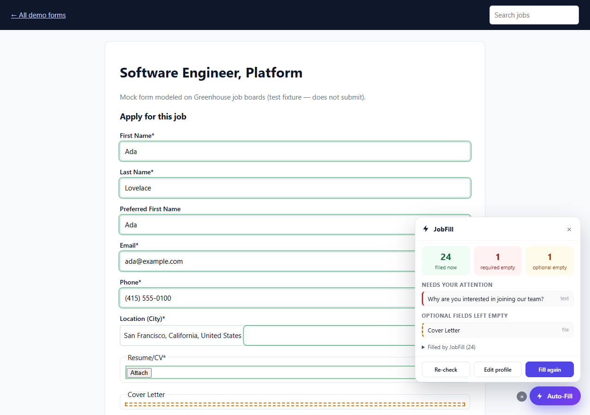
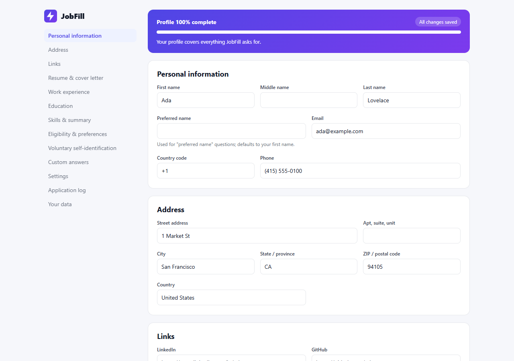
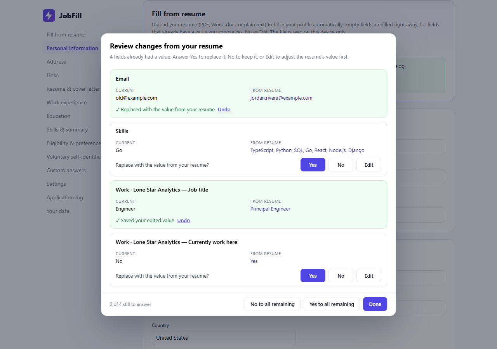

# JobFill — job application autofill for Chrome

[](https://github.com/philliphjhuang/jobfill/actions/workflows/ci.yml)


JobFill is a privacy-first Chrome extension that fills out job applications for you. Save your
details once — name, contact info, links, resume, work history, education, eligibility answers,
preferred locations and voluntary self-identification answers — then open any application and
click **Auto-Fill**. When it finishes, JobFill re-checks every field on the page and points out
anything that is still empty.

Everything is stored locally in your browser. There is no account, no server and no tracking.

| Auto-Fill + verification panel                                                | Profile editor                                             |
| ----------------------------------------------------------------------------- | ---------------------------------------------------------- |
|       |           |
| Filled fields are outlined in green; what's still empty is listed and linked. | One page for everything JobFill can answer, saved locally. |

_Screenshots are captured by the end-to-end test running against the bundled demo forms._

## Features

- **Set up your profile from your resume.** Upload a PDF, Word (.docx) or text resume and JobFill
  reads your name, contact details, links, work history, education and skills. Empty profile
  fields are filled immediately; for any field that already has a different value you're asked
  **Yes** (replace), **No** (keep yours) or **Edit** (adjust the resume's value first). The file
  is parsed on your device — nothing is uploaded.
- **One-click fill** from a floating button on application pages, the toolbar popup, or
  <kbd>Alt</kbd>+<kbd>Shift</kbd>+<kbd>F</kbd>.
- **Types like a person** (default): every field is typed one character at a time with a random
  0.1–0.9 s between characters, and there's a random 3–7 s pause before moving to the next field.
  The panel shows live progress ("Field 7 of 28 · Typing: Email", time left) and a **Stop**
  button. Both ranges are adjustable — or turn it off to fill instantly — under Settings.
- **Resume upload first.** Workday, Lever, Greenhouse and Ashby parse your resume and pre-fill
  fields; JobFill uploads it, waits for the page to settle, then fills only what is still empty.
- **Work experience and education**: fills every entry (most recent first) and clicks
  "Add another" when the form has fewer slots than your profile. Handles split month/year dates,
  "I currently work here" and every common date format.
- **Eligibility and preference questions**: work authorization, sponsorship (including inverse
  "…without sponsorship?" wording), 18+, relocation, remote/hybrid/on-site, preferred locations,
  years of experience ranges ("3-5 years"), salary, start date, notice period, how you heard.
- **Voluntary self-identification** (gender, race/ethnicity, Hispanic/Latino, veteran, disability,
  and more), mapped onto each site's wording — "Decline to self-identify", "I don't wish to
  answer" and "Prefer not to say" are all understood. Can be turned off.
- **Custom answers** for anything else: "previously worked for" → "No".
- **Verification pass**: after filling, every field is re-read from the page. Empty required fields
  are outlined in red, optional ones in amber, and listed in a panel — click one to jump to it.
- **Adaptive**: understands `<label>`s, ARIA labels, placeholders, nearby text, section headings,
  `name`/`id`/`data-automation-id` attributes, `autocomplete` hints, shadow DOM, iframes, React
  controlled inputs, React-Select style comboboxes, Workday button dropdowns, radio/checkbox groups
  and native selects.
- **Never overwrites** what you already typed (unless you ask it to), never submits the form, and
  never checks consent/terms boxes for you.
- **Application log** of the pages you auto-filled (stored locally, can be disabled).

Tuned for Greenhouse, Lever, Workday, Ashby, SmartRecruiters, iCIMS, Jobvite, BambooHR,
Workable, Taleo, SuccessFactors and more, with generic heuristics for any other careers page.

## Install

### From source (developer mode)

```bash
npm ci
npm run build
```

1. Open `chrome://extensions` and enable **Developer mode**.
2. Click **Load unpacked** and select the `dist/` folder.
3. The profile editor opens automatically. Use **Fill from resume** at the top to start from your
   resume, then review and complete the remaining sections.

### From a release

Download `jobfill-vX.Y.Z.zip` from the Releases page, unzip it and load the folder as above (or
install from the Chrome Web Store once published).

## Usage

1. Open a job application. On recognized pages a purple **Auto-Fill** button appears in the
   bottom-right corner.
2. Click it. JobFill uploads your resume and types the form field by field while the panel shows
   progress. With the default human-like pacing a typical application takes about 5–15 minutes
   (a long cover letter adds more); keep the tab in front — typing pauses while it is in the
   background. Press **Stop** at any time.
3. Review the highlighted fields — red means required and still empty (usually essay questions or
   consent boxes). Click an item in the panel to jump to it.
4. Multi-step forms (e.g. Workday): click **Auto-Fill** again on each step.
5. Review everything and submit the application yourself.

Try it safely on the bundled mock forms: `npm run demo`, then open <http://localhost:5173>.
`demo/sample-resume.pdf` and `demo/sample-resume.docx` are fictional resumes you can use to try
**Fill from resume**.

### Filling your profile from a resume



1. Profile editor → **Fill from resume** → **Choose resume file…** (or **Use saved resume**, or
   **Fill profile from it** next to the resume in _Resume & cover letter_).
2. Every empty field is filled right away and listed under _What was filled_.
3. If a field already had a different value, a dialog asks for each one: **Yes** replaces it,
   **No** keeps yours, **Edit** lets you correct the resume's value before saving. Each answer can be
   undone; closing the dialog keeps every field you didn't answer.
4. Parsing is best-effort (resume layouts vary a lot), so glance over the sections afterwards.
   Scanned/image-only PDFs contain no text and can't be read; legacy `.doc` files aren't
   supported — save as `.docx` or PDF.

## Development

| Command             | What it does                                                  |
| ------------------- | ------------------------------------------------------------- |
| `npm run dev`       | Rebuild `dist/` on every change (reload the extension after). |
| `npm run build`     | Production build into `dist/`.                                |
| `npm test`          | Unit + integration tests (Vitest + jsdom).                    |
| `npm run coverage`  | Tests with a coverage report and thresholds.                  |
| `npm run test:e2e`  | Loads `dist/` into real Chrome and fills every demo form.     |
| `npm run lint`      | ESLint (TypeScript, security rules).                          |
| `npm run typecheck` | `tsc --noEmit` in strict mode.                                |
| `npm run format`    | Prettier.                                                     |
| `npm run check`     | Everything CI runs: typecheck, lint, format, tests, build.    |
| `npm run package`   | Build and zip `release/jobfill-vX.Y.Z.zip` for the Web Store. |
| `npm run demo`      | Serve the mock application forms on port 5173.                |

Requires Node.js 20+. `test:e2e` needs Chrome installed (set `CHROME_PATH` if it is not in the
default location).

### Project layout

```
src/
  engine/       Form understanding + filling (pure DOM, no chrome.* APIs)
    scanner.ts    find controls, labels, groups, sections
    classifier.ts rules.ts   decide what each field asks for
    resolver.ts   turn profile data into the value to enter
    fillers.ts    write values (text, select, radio, checkbox, combobox, file)
    engine.ts     orchestrate a run + verification pass
  content/      Content script: floating button, results panel, messaging
  background/   Service worker: runs the engine in every frame, merges reports
  popup/        Toolbar popup
  options/      Profile editor (schema-driven) + resume import dialog
  resume/       Resume import: extract.ts (PDF via pdf.js, DOCX, TXT) → parse.ts → merge.ts
  shared/       Types, storage, report model
demo/           Mock ATS-style forms (manual QA + integration test fixtures)
tests/          unit/, integration/, e2e/
docs/           Requirements, architecture, ADRs, test plan, release process
```

## Documentation

- [Software requirements](docs/REQUIREMENTS.md)
- [Architecture & design](docs/ARCHITECTURE.md) and [decision records](docs/adr/)
- [Test plan](docs/TEST_PLAN.md)
- [Release process](docs/RELEASE.md)
- [How this project maps to the SDLC](docs/SDLC.md)
- [Contributing](CONTRIBUTING.md) · [Security](SECURITY.md) · [Privacy](PRIVACY.md) ·
  [Changelog](CHANGELOG.md)

## Privacy in one paragraph

Your profile, documents and settings live in `chrome.storage.local` on your computer. JobFill makes
no network requests of its own, has no analytics and no remote code. It reads pages only to find
form fields and only writes to them when you click Auto-Fill. See [PRIVACY.md](PRIVACY.md).

## License

[MIT](LICENSE) © 2026 Phillip Huang
