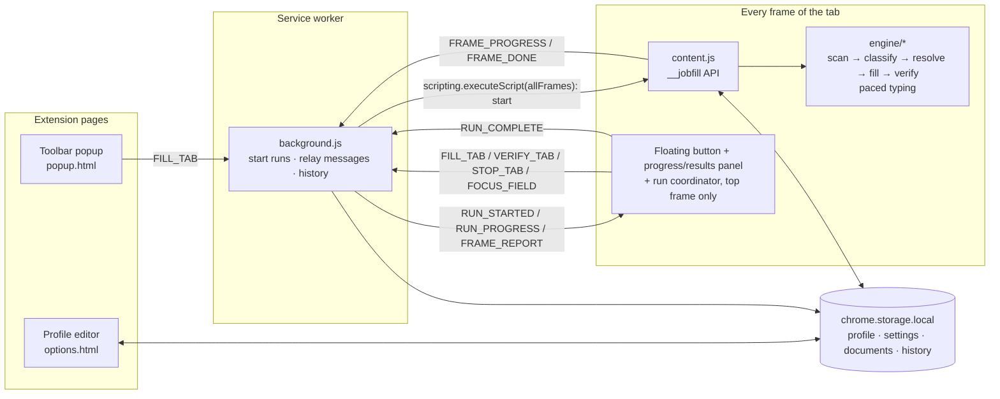
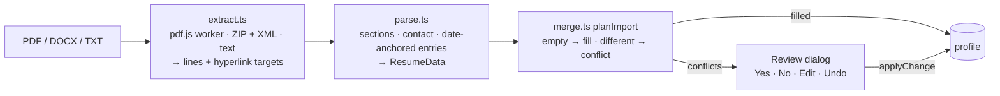

# Architecture & Design

## 1. Overview

JobFill is a Manifest V3 extension with no backend. The "server side" of the application is the
extension's **service worker** plus the **local storage layer**; the "client side" is the popup,
the profile editor and the in-page UI. The form-understanding logic lives in an **engine** that
depends only on the DOM, so it runs identically in every frame and in unit tests.



## 2. Components

| Component      | Path                                           | Responsibility                                                                                           |
| -------------- | ---------------------------------------------- | -------------------------------------------------------------------------------------------------------- |
| Engine         | `src/engine/`                                  | Pure DOM logic: discover controls, classify, resolve values, fill, verify, highlight. No `chrome.*`.     |
| Content script | `src/content/index.ts`                         | Registers `globalThis.__jobfill` (`start`/`stop`/`focus`), detects application pages, hosts the panel.   |
| Coordinator    | `src/content/coordinator.ts`                   | Top frame: waits for every started frame's report (in any order) and merges them into one result.        |
| Panel          | `src/content/panel.ts`                         | Floating button, live progress with Stop, and results UI inside an open shadow root.                     |
| Pacing         | `src/engine/pacing.ts`, `src/engine/typing.ts` | Random keystroke/field pauses, Stop handling, background-tab pause; per-character keyboard/input events. |
| Service worker | `src/background/`                              | Starts runs in all frames, relays progress/reports/Stop, forwards focus requests, records history.       |
| Profile editor | `src/options/`                                 | Schema-driven form (`schema.ts`) bound to storage with autosave, documents, import/export, log.          |
| Resume import  | `src/resume/`, `src/options/resume-import.ts`  | Extract text from PDF/DOCX/TXT, parse it into profile data, plan the merge, run the Yes/No/Edit review.  |
| Popup          | `src/popup/`                                   | Completeness summary and a fill button for the active tab.                                               |
| Shared         | `src/shared/`                                  | Types, defaults/migration, storage wrapper, report model, file helpers.                                  |

## 3. A fill, step by step

Runs are **event-driven**. A paced fill types one character at a time and can take many minutes,
and Chrome terminates a service worker that spends more than 5 minutes on a single call, so the
worker only _starts_ the run; frames report progress and results by message, and the top frame
assembles the outcome ([ADR 0005](adr/0005-human-paced-typing-and-event-driven-runs.md)).

```mermaid
sequenceDiagram
  actor User
  participant Panel as Panel + coordinator (top frame)
  participant SW as Service worker
  participant F as Each frame (__jobfill)
  participant E as FillEngine

  User->>Panel: click Auto-Fill
  Panel->>SW: FILL_TAB
  SW->>F: executeScript(allFrames): inject content.js where missing
  SW->>F: executeScript(allFrames): __jobfill.start('fill', runId)
  F-->>SW: 'started' | 'no-form' | 'busy' (returns at once)
  SW->>Panel: RUN_STARTED(runId, frameIds) → progress view + Stop
  F->>E: new FillEngine(document, data, { signal, onProgress })
  E->>E: scan + classify, estimate time; upload resume, wait for DOM to settle
  E->>E: click "Add" for missing work/education entries
  loop every field (page order), then fields revealed by earlier answers
    E->>E: pause 3–7 s (not before the first field), type 0.1–0.9 s per character
    E-->>SW: FRAME_PROGRESS → RUN_PROGRESS → panel
  end
  E->>E: verify: re-read every field, highlight, collect missing
  F-->>SW: FRAME_DONE(report)
  SW->>Panel: FRAME_REPORT(frameId, report)
  Panel->>Panel: all started frames reported → mergeFrameReports → show results
  Panel->>SW: RUN_COMPLETE → application log
  User->>Panel: Stop (any time)
  Panel->>SW: STOP_TAB → STOP_RUN to every frame → current field finished, then verify + report
```

## 4. Engine pipeline

| Stage    | Module                                   | Key ideas                                                                                                                                                                                                                                                                                                                                                                                                   |
| -------- | ---------------------------------------- | ----------------------------------------------------------------------------------------------------------------------------------------------------------------------------------------------------------------------------------------------------------------------------------------------------------------------------------------------------------------------------------------------------------- |
| Scan     | `scanner.ts`, `context.ts`               | Walks the DOM including open shadow roots; groups radios/checkboxes; label from `aria-labelledby` → `<label>` → `aria-label` → nearby text; group labels for split dates; section from ancestors' ids and the nearest preceding heading; required from `required`/`aria-required`/`*`/`✱`.                                                                                                                  |
| Classify | `classifier.ts`, `rules.ts`              | Declarative rules scored across signals (hint 120, autocomplete 100, custom answer 72–90, label 60, attributes 40, placeholder 35) with priorities and section gating; options-based fallback for vague questions.                                                                                                                                                                                          |
| Index    | `entries.ts`                             | Work/education fields get an entry index from numbered headings or by detecting a repeated field type.                                                                                                                                                                                                                                                                                                      |
| Resolve  | `resolver.ts`, `synonyms.ts`, `dates.ts` | Profile → `{ text, candidates, multi, bool, number, file }`. Synonym tables for EEO wording, countries, US states, degrees, months, referral sources; inverse questions ("…without sponsorship", "under 18").                                                                                                                                                                                               |
| Match    | `matcher.ts`                             | Exact → prefix → whole-word containment → token Dice; negation-aware; placeholder options ignored; numeric range parsing for "3-5 years" / "$100k-$120k".                                                                                                                                                                                                                                                   |
| Fill     | `fillers.ts`                             | Native value setters + input/change events (React-safe); click for radios/checkboxes; open/type/pick for comboboxes; `DataTransfer` for files; all clicks run under a submit guard.                                                                                                                                                                                                                         |
| Pace     | `pacing.ts`, `typing.ts`                 | Each filler "approaches" its field (scroll into view, 3–7 s pause except before the first field); text and typeahead searches are typed per character (keydown → keypress → beforeinput → value → input → keyup, 0.1–0.9 s apart); masks that cancel a key are respected; native date pickers and number buffers get complete values; a stopped field is completed at once; paused while the tab is hidden. |
| Verify   | `engine.ts`, `values.ts`                 | Reads the displayed value of every control kind (incl. combobox chips and uploaded-file names) and reports what is empty.                                                                                                                                                                                                                                                                                   |

### Scoping

`scopeToApplication` keeps only forms with at least two recognized fields, so newsletter boxes and
site search are ignored. Header/nav/footer/search regions are excluded during scanning.

### ATS adapters

`ats.ts` identifies the platform (for the report and log) and supplies optional selector hints.
The generic heuristics are the primary mechanism; the demo tests intentionally run _without_
hints to prove that.

## 5. Resume import

Runs only in the profile editor (never on job sites).



| Stage   | Key ideas                                                                                                                                                                                                                                                                                                                                                                                                                                                                                                                                               |
| ------- | ------------------------------------------------------------------------------------------------------------------------------------------------------------------------------------------------------------------------------------------------------------------------------------------------------------------------------------------------------------------------------------------------------------------------------------------------------------------------------------------------------------------------------------------------------- |
| Extract | **PDF:** pdf.js text items are grouped by baseline and sorted by x; wide horizontal gaps (right-aligned dates, second column) become tabs; link annotations are collected. **DOCX:** a small ZIP reader + native `DecompressionStream`; paragraphs → lines, `numPr` → bullets, table rows → tab-separated, hyperlink relationships → links.                                                                                                                                                                                                             |
| Parse   | Headings (Experience, Education, Skills… ~90 aliases) split sections; the block above the first heading holds name/contact. Work entries are anchored on date ranges ("Jan 2020 – Present", "06/2019 - 2021", "Fall 2019"); the layout (dates on the title line vs. under a company line) is detected from the first entry. Title / company / location are assigned by keyword and place patterns. Education entries are anchored on school names; degrees (long form or B.S./MBA/PhD…), field, GPA and single/expected graduation dates are extracted. |
| Plan    | Each field is compared with the saved profile: blank → filled at once; equivalent (case, punctuation, URL scheme, phone formatting, matched company name) → skipped; different → conflict. Work/education entries are matched by company/school similarity; unmatched ones are appended. Yes/no flags count as empty only on entries that held no data before the import.                                                                                                                                                                               |
| Review  | Each conflict is a card showing current vs. resume value. Yes applies the resume value, No keeps the current one, Edit opens a typed editor (text / textarea / month / yes-no) and saves the edited value. Undo reverts; closing keeps unanswered fields. A different saved resume file is offered for replacement the same way (Yes/No only).                                                                                                                                                                                                          |

pdf.js (`pdfjs-dist` 4.10.38) is bundled only into `options.js`; its worker ships as
`pdf.worker.min.mjs` in the extension package. It runs with `isEvalSupported: false` (see
[ADR 0004](adr/0004-local-resume-parsing-with-pdfjs.md)).

## 6. Data model

Defined in `src/shared/types.ts`. Stored under separate keys so the (large) documents are only read
when needed:

| Key         | Type             | Notes                                                        |
| ----------- | ---------------- | ------------------------------------------------------------ |
| `profile`   | `Profile`        | `schemaVersion` for migrations; normalized on every load.    |
| `settings`  | `Settings`       | Floating button mode, overwrite, uploads, EEO, highlighting. |
| `documents` | `Documents`      | Resume / cover letter as base64 (≤ 10 MB each).              |
| `history`   | `HistoryEntry[]` | Newest first, capped at 200.                                 |

`mergeWithDefaults` makes loading forward- and backward-compatible: unknown keys are dropped,
missing keys get defaults, wrong types are rejected. The same routine sanitizes imported JSON.

## 7. Security & privacy design

- No network access is used; `host_permissions` exist only so content scripts can read and fill
  forms on any careers site.
- All UI built with `src/ui/h.ts`, which assigns text via text nodes. ESLint forbids `innerHTML`
  in source; a unit test proves page labels such as `` render as text.
- In-page UI is isolated in a shadow root; the engine skips it when scanning.
- `withSubmitGuard` cancels form submission while JobFill clicks buttons.
- Nothing is sent to pages except the values the user asked to fill.

## 8. Extending

- **New question** → add a rule to `rules.ts` (+ synonyms/resolver if it needs a new profile
  field) and a case to `tests/unit/classifier.test.ts`.
- **New widget library** → teach `findListboxOptions`/`comboboxValue` its option and value
  selectors and add a fixture to `demo/`.
- **New ATS** → add an entry to `ADAPTERS` with host pattern and, if needed, selector hints.

See also the [architecture decision records](adr/).
