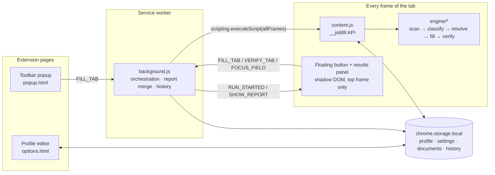

# Architecture & Design

## 1. Overview

JobFill is a Manifest V3 extension with no backend. The "server side" of the application is the
extension's **service worker** plus the **local storage layer**; the "client side" is the popup,
the profile editor and the in-page UI. The form-understanding logic lives in an **engine** that
depends only on the DOM, so it runs identically in every frame and in unit tests.



## 2. Components

| Component      | Path                   | Responsibility                                                                                           |
| -------------- | ---------------------- | -------------------------------------------------------------------------------------------------------- |
| Engine         | `src/engine/`          | Pure DOM logic: discover controls, classify, resolve values, fill, verify, highlight. No `chrome.*`.     |
| Content script | `src/content/index.ts` | Registers `globalThis.__jobfill`, detects application pages, hosts the panel, relays messages.           |
| Panel          | `src/content/panel.ts` | Floating button and results UI inside an open shadow root.                                               |
| Service worker | `src/background/`      | Runs the engine in all frames, merges frame reports, forwards focus requests, records history, shortcut. |
| Profile editor | `src/options/`         | Schema-driven form (`schema.ts`) bound to storage with autosave, documents, import/export, log.          |
| Popup          | `src/popup/`           | Completeness summary and a fill button for the active tab.                                               |
| Shared         | `src/shared/`          | Types, defaults/migration, storage wrapper, report model, file helpers.                                  |

## 3. A fill, step by step

```mermaid
sequenceDiagram
  actor User
  participant Panel as Panel (top frame)
  participant SW as Service worker
  participant F as Each frame (__jobfill)
  participant E as FillEngine

  User->>Panel: click Auto-Fill
  Panel->>SW: FILL_TAB
  SW->>Panel: RUN_STARTED (spinner)
  SW->>F: executeScript(allFrames): inject content.js where missing
  SW->>F: executeScript(allFrames): __jobfill.run('fill')
  F->>E: new FillEngine(document, stored data)
  E->>E: scan + classify; skip frames without an application
  E->>E: upload resume, wait for DOM to settle
  E->>E: click "Add" for missing work/education entries
  E->>E: fill pass (page order), settle, second pass for revealed fields
  E->>E: verify: re-read every field, highlight, collect missing
  F-->>SW: FrameReport (serializable)
  SW->>SW: mergeFrameReports, append history
  SW->>Panel: SHOW_REPORT
  User->>Panel: click a missing field
  Panel->>SW: FOCUS_FIELD(frameId, ref)
  SW->>F: FOCUS_FIELD → scroll + focus
```

## 4. Engine pipeline

| Stage    | Module                                   | Key ideas                                                                                                                                                                                                                                                                                  |
| -------- | ---------------------------------------- | ------------------------------------------------------------------------------------------------------------------------------------------------------------------------------------------------------------------------------------------------------------------------------------------ |
| Scan     | `scanner.ts`, `context.ts`               | Walks the DOM including open shadow roots; groups radios/checkboxes; label from `aria-labelledby` → `<label>` → `aria-label` → nearby text; group labels for split dates; section from ancestors' ids and the nearest preceding heading; required from `required`/`aria-required`/`*`/`✱`. |
| Classify | `classifier.ts`, `rules.ts`              | Declarative rules scored across signals (hint 120, autocomplete 100, custom answer 72–90, label 60, attributes 40, placeholder 35) with priorities and section gating; options-based fallback for vague questions.                                                                         |
| Index    | `entries.ts`                             | Work/education fields get an entry index from numbered headings or by detecting a repeated field type.                                                                                                                                                                                     |
| Resolve  | `resolver.ts`, `synonyms.ts`, `dates.ts` | Profile → `{ text, candidates, multi, bool, number, file }`. Synonym tables for EEO wording, countries, US states, degrees, months, referral sources; inverse questions ("…without sponsorship", "under 18").                                                                              |
| Match    | `matcher.ts`                             | Exact → prefix → whole-word containment → token Dice; negation-aware; placeholder options ignored; numeric range parsing for "3-5 years" / "$100k-$120k".                                                                                                                                  |
| Fill     | `fillers.ts`                             | Native value setters + input/change events (React-safe); click for radios/checkboxes; open/type/pick for comboboxes; `DataTransfer` for files; all clicks run under a submit guard.                                                                                                        |
| Verify   | `engine.ts`, `values.ts`                 | Reads the displayed value of every control kind (incl. combobox chips and uploaded-file names) and reports what is empty.                                                                                                                                                                  |

### Scoping

`scopeToApplication` keeps only forms with at least two recognized fields, so newsletter boxes and
site search are ignored. Header/nav/footer/search regions are excluded during scanning.

### ATS adapters

`ats.ts` identifies the platform (for the report and log) and supplies optional selector hints.
The generic heuristics are the primary mechanism; the demo tests intentionally run _without_
hints to prove that.

## 5. Data model

Defined in `src/shared/types.ts`. Stored under separate keys so the (large) documents are only read
when needed:

| Key         | Type             | Notes                                                        |
| ----------- | ---------------- | ------------------------------------------------------------ |
| `profile`   | `Profile`        | `schemaVersion` for migrations; normalized on every load.    |
| `settings`  | `Settings`       | Floating button mode, overwrite, uploads, EEO, highlighting. |
| `documents` | `Documents`      | Resume / cover letter as base64 (≤ 10 MB each).              |
| `history`   | `HistoryEntry[]` | Newest first, capped at 200.                                 |

`mergeWithDefaults` makes loading forward- and backward-compatible: unknown keys are dropped,
missing keys get defaults, wrong types are rejected. The same routine sanitizes imported JSON.

## 6. Security & privacy design

- No network access is used; `host_permissions` exist only so content scripts can read and fill
  forms on any careers site.
- All UI built with `src/ui/h.ts`, which assigns text via text nodes. ESLint forbids `innerHTML`
  in source; a unit test proves page labels such as `` render as text.
- In-page UI is isolated in a shadow root; the engine skips it when scanning.
- `withSubmitGuard` cancels form submission while JobFill clicks buttons.
- Nothing is sent to pages except the values the user asked to fill.

## 7. Extending

- **New question** → add a rule to `rules.ts` (+ synonyms/resolver if it needs a new profile
  field) and a case to `tests/unit/classifier.test.ts`.
- **New widget library** → teach `findListboxOptions`/`comboboxValue` its option and value
  selectors and add a fixture to `demo/`.
- **New ATS** → add an entry to `ADAPTERS` with host pattern and, if needed, selector hints.

See also the [architecture decision records](adr/).
